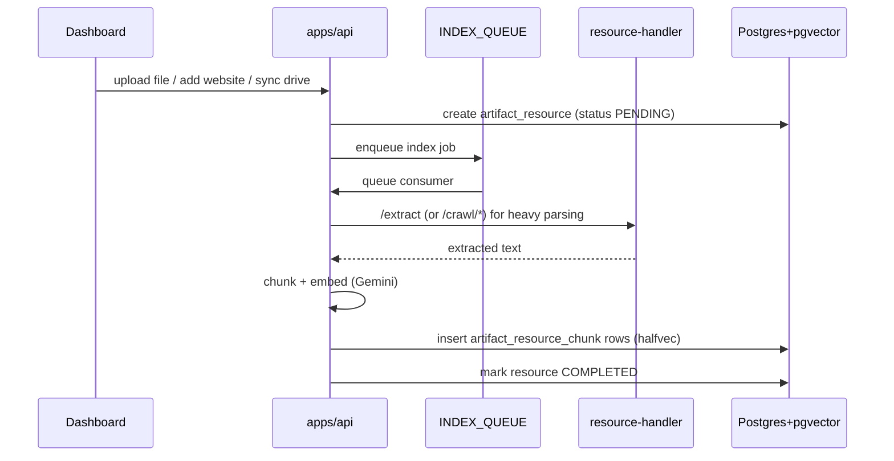
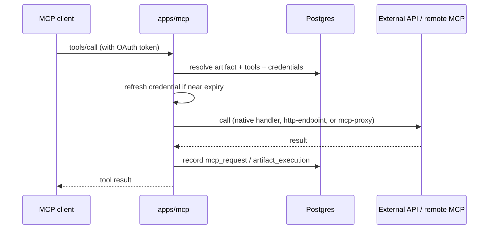

# Architecture

This document explains how Ganju is put together: the apps, how requests flow, and the Cloudflare resources each part depends on. For the database entities, see [DATA_MODEL.md](DATA_MODEL.md).

## The big idea

Everything centers on the **artifact**. An artifact is a project's MCP server: it owns prompts, resources, tools, credentials, and channels. When a client connects to `https://mcp.<domain>/<slug>`, the MCP Worker resolves the slug to an artifact and assembles a live MCP server from the artifact's configured pieces.

```
user → organization → project → artifact → { prompts, resources, tools, credentials, channels }
```

## The seven apps

### `apps/api` — control-plane Worker

A [Hono](https://hono.dev) Worker ([`apps/api/src/index.ts`](../apps/api/src/index.ts)) that everything except live MCP traffic goes through:

- **Auth** — [better-auth](https://www.better-auth.com) handles social login (Google, GitHub) and, via `@better-auth/oauth-provider`, acts as an **OAuth 2.1 / OIDC provider** so MCP clients can do OAuth. Discovery is advertised at `/.well-known/oauth-authorization-server`; the consent screen is served at `/oauth/consent`.
- **CRUD** — organizations, projects, artifacts, prompts, resources, tools, credentials, channels, and org-level LLM configs. Controllers live under [`apps/api/src/controllers`](../apps/api/src/controllers).
- **Integration OAuth** — `GET /oauth/:provider/authorize` + callbacks for Gmail, Google Drive/Calendar, Outlook, OneDrive, and Slack.
- **Channel webhooks** — `POST /channel/:channelId/webhook/:platform` ingests Telegram/Slack/WhatsApp/Discord events — text and voice notes (see [Channel bot turn](#channel-bot-turn)); a Discord **Durable Object** ([`durable-objects/discordGateway.ts`](../apps/api/src/durable-objects/discordGateway.ts)) holds the persistent Gateway WebSocket.
- **Queue consumers** — the `queue()` handler dispatches background jobs (see [Queues](#queues-background-work)).

### `apps/mcp` — MCP-server Worker

A small Hono Worker ([`apps/mcp/src/index.ts`](../apps/mcp/src/index.ts)) that **is** the MCP server. It's stateless: a fresh `McpServer` is built per request from the artifact's stored config, then it handles `initialize` / `tools/list` / `tools/call` / `resources/*` / `prompts/*`.

- Auth gate runs only on artifact-bearing routes; `/.well-known/oauth-protected-resource` is public so a 401 can point clients at the authorization server.
- Tool dispatch and the tool catalog are documented in depth in [`apps/mcp/src/tools/README.md`](../apps/mcp/src/tools/README.md) — read that before adding or changing a tool.
- Heavy or binary work is delegated to the resource-handler container; tool handlers stay light.

### `apps/resource-handler` — Node container

A plain Node HTTP server ([`apps/resource-handler/src/server.ts`](../apps/resource-handler/src/server.ts)) packaged as a **Cloudflare Container** and reached over a Durable Object binding (`RESOURCE_HANDLER`). Workers are capped at 128 MiB and can't run native binaries, so anything heavy lives here:

- **Document extraction** (`/extract`) — PDF, Word, Excel → text, for embedding.
- **Web crawling** (`/crawl/discover`, `/crawl/page`) — Cheerio or Playwright.
- **Large file sends** — pushing resources into Gmail/Outlook/Slack/Telegram/Discord/WhatsApp, including streaming a proxied remote MCP resource as a file without it transiting a Worker.

### `apps/tool-broker` — the host capabilities a user's tool is given

A Hono Worker ([`apps/tool-broker/src/index.ts`](../apps/tool-broker/src/index.ts)) reached over a **service binding** from inside a customer's deployed script. It is what makes `ctx` in [`@ganju/sdk`](../packages/sdk) real: `connection()` mints a short-lived access token, `secret()` resolves an `artifact_credential` by label, `resources.*` reads, creates and deletes the artifact's resources, and `sendFile()` forwards to the resource-handler container the way the native Gmail/Outlook/Slack handlers do.

Two properties it exists to hold, neither of which could live in the SDK:

- **Secrets never enter user code.** Refresh tokens and client secrets stay here; the isolate only ever sees an access token with an expiry.
- **A service binding carries no caller identity**, so the script is authenticated by `GANJU_TOOL_TOKEN` — an HMAC over `{artifactId, versionId}` injected at upload time, verified here against the artifact's *current* active version. That is what makes a superseded script's credential stop working the moment a newer version publishes. The artifact id is never read from the request body.

### `apps/tool-outbound` — the egress screen for user code

A small Worker ([`apps/tool-outbound/src/index.ts`](../apps/tool-outbound/src/index.ts)) that every outbound `fetch` from a customer's script goes through: the shared SSRF screen (`isBlockedHost` — private, loopback, link-local), the tool's `allowedHosts` when set, and the per-artifact rate limit.

**Enforcement is here rather than in the SDK on purpose** — anything inside the isolate is user-editable and therefore not a control. An empty `allowedHosts` means unrestricted rather than blocked, but `isBlockedHost` applies whatever the list says. Note it screens global `fetch` only: a container binding is not intercepted, which is why the embedding host needs an exemption and the `sendFile` container call never did.

Both Workers are deployed per environment (`ganju-tool-broker-development`, `ganju-tool-outbound-development`). What a tool author sees of them — `ctx`, settings, limits — is documented in [the Functions docs](../apps/website/src/content/docs/tools/functions.md) and the [`@ganju/sdk`](../packages/sdk) and [`ganju` CLI](../packages/cli) READMEs.

### `apps/data` — projects' databases

A Worker ([`apps/data/src/index.ts`](../apps/data/src/index.ts)) whose only job is the `ProjectDatabase` class: a **SQLite-backed Durable Object per artifact**, addressed as `idFromName(artifactId)`, holding that project's tables and rows. It has no public routes. apps/api, apps/mcp and apps/tool-broker bind to it with `script_name = "ganju-data-<env>"` and call it over JS RPC, always through `databaseStub` in `@ganju/db`; a customer's script has no binding and reaches data only through the broker.

- **The object is the only place SQL is built.** The engine lives in [`packages/utils/src/dataEngine.ts`](../packages/utils/src/dataEngine.ts) (pure, run by the object through a small runner, and by the tests and the tool-design eval on `node:sqlite`): identifiers are checked against the database's own metadata, every value is a bound parameter, inserts split at 100 parameters, and every call is bounded before it runs (500 rows or 1 MB a page; an unindexed sort or aggregate over 200k rows needs an indexed filter).
- **Self-describing.** Display metadata (labels, descriptions, types, access, relations) lives inside the object in `_ganju_tables` / `_ganju_columns`, so a point-in-time restore brings it back with the data. Our own tables migrate in the constructor the first time an object is used after a deploy.
- **Every call returns a `DataResult`** — the value or a coded error, plus the rows SQLite read and wrote — never a raw SQLite error. The caller times the call (the object's clock doesn't move during synchronous SQL) and adds the rows to the org's meters once per request.
- **One request at a time, real transactions.** A write list runs in one `transactionSync`, so "two orders for the last pizza" can't both succeed. Row history is kept by triggers, with the actor every write names.
- **Restore, delete, export.** Point-in-time recovery (30 days, undoable) is the backup. Deleting is soft: the object refuses calls, and the hourly purge in apps/api runs `deleteAll()` after 7 days. Exports are written to R2 a step at a time by the object's alarm.

### `apps/web` — dashboard

A [Next.js](https://nextjs.org) app (Pages Router, MUI/Emotion) deployed to Cloudflare via [OpenNext](https://opennext.js.org). It talks to `apps/api` over REST and is where users manage every entity above. Components live under [`apps/web/src/components/views`](../apps/web/src/components/views).

## Shared packages

| Package                                         | Role                                                                                                                                                                                                                        |
| ----------------------------------------------- | --------------------------------------------------------------------------------------------------------------------------------------------------------------------------------------------------------------------------- |
| [`packages/db`](../packages/db)                 | Drizzle schema ([`lib/schema.ts`](../packages/db/src/lib/schema.ts)), connection via Hyperdrive, migrations, shared error handler                                                                                           |
| [`packages/utils`](../packages/utils)           | The shared kernel: [`constants.ts`](../packages/utils/src/constants.ts) (mime types, provider URLs, platform caps, LLM catalog, chunking config), crypto, OAuth refresh, SSRF screening, chunking, per-channel send helpers |
| [`packages/ui`](../packages/ui)                 | MUI-based component library used by the web app                                                                                                                                                                             |
| [`packages/containers`](../packages/containers) | The `ResourceHandler` Cloudflare Container class                                                                                                                                                                            |
| [`packages/sdk`](../packages/sdk)               | `@ganju/sdk` — the typed `ctx` a user's tool is written against, and the module attached beside every deployed script                                                                                                        |
| [`packages/cli`](../packages/cli)               | `ganju` — write, deploy and debug custom tools from a terminal; a thin client of the same endpoints the dashboard uses                                                                                                       |
| [`packages/tsconfig`](../packages/tsconfig)     | Shared TypeScript config                                                                                                                                                                                                    |

## Data flow examples

### Ingesting a resource (RAG)



Search is hybrid: the top 50 chunks by cosine distance over `artifact_resource_chunk.embedding` (1536-dim `halfvec`, HNSW) and the top 50 full-text matches over the generated `content_tsv` column (`to_tsvector('simple', content)`, GIN) are merged with reciprocal rank fusion (k = 60). The full-text query ORs the query's words, leaving out English/Spanish stopwords and any word found in more than a tenth of the artifact's chunks, so "estado del pedido ORD-48215" still finds the English order line. `hnsw.iterative_scan = relaxed_order` is set on the database so the `artifact_id` filter doesn't starve the HNSW scan of candidates. One function, `db.searchResourceChunks`, serves both `search-resources` and `ctx.resources.search`. A cross-encoder rerank (Workers AI `bge-reranker-base`, via the `AI` binding) can reorder the top 30 before the cut to `limit`, but it is off by default (`RESOURCE_SEARCH_RERANK_ENABLED`): on the golden sets the fused order matched or beat it and it cost 0.5–0.9 s a search. The search eval turns it on per request with `--rerank` to re-measure.

### Answering an MCP tool call



### Channel bot turn

A chat platform posts a webhook to `apps/api`, which runs an LLM tool-calling loop (the org's configured model, or the shared platform one — see [MODELS.md](MODELS.md)) against the artifact's MCP `Client`, then replies on the platform. Resources reach the agent through the native `resources` tool group, and MCP prompts surface as slash commands — both detailed in the [tools README](../apps/mcp/src/tools/README.md#channel-bots-telegram).

The webhook only classifies the message and hands it to the `MessageBufferDO`, which holds one participant's burst until they pause and then runs the turn through `/channel/:id/ingest/debounced`. That route has no 30-second `waitUntil` ceiling, so anything slow happens there:

- **Voice notes** (WhatsApp, Telegram, Slack, Discord) are buffered by reference — a media id, file id or attachment URL — and each platform hands the runner a function that downloads one from its own hosts. The runner transcribes only once the turn is known to run (message cap, shared-key backstop and per-customer limit all pass), and the transcript follows any caption or text sent with the note. A note that can't be read keeps that text; with nothing else to go on the customer is asked to type it, in a recorded reply ([`voiceNotes.ts`](../apps/api/src/controllers/channel/voiceNotes.ts)).
- **Per-customer limit** — before the model loop, the runner counts the participant's replies in the last 24 hours (`channel.config.participantDailyLimit`, default 50, 0 = off). Each time a customer reaches it, their first message gets a notice and later ones nothing, with no model call and nothing billed; the notice is claimed under a per-participant lock, so messages arriving together get one between them.
- **Customer memory** — with `channel.config.participantMemory` on, in private conversations the runner adds its own `remember-customer` tool and puts the saved facts in the system prompt; they live on `channel_participant.memory`. Each save applies to the stored row under a lock, so a "Forget" during a turn holds, and a save made after the turn read outside content waits for the customer's yes like a sensitive tool.

## Cloudflare bindings

Defined per app in `wrangler.toml` (see [`apps/api/wrangler.toml`](../apps/api/wrangler.toml) for the full set). The API Worker is the binding hub:

| Binding            | Type                       | Purpose                                          |
| ------------------ | -------------------------- | ------------------------------------------------ |
| `HYPERDRIVE`       | Hyperdrive                 | Pooled Postgres connection                       |
| `STORAGE_BUCKET`   | R2                         | Uploaded files / avatars                         |
| `SEND_EMAIL`       | Email Service              | Transactional email (invitations, contact, alerts) |
| `RESOURCE_HANDLER` | Durable Object → Container | Heavy work delegation                            |
| `DISCORD_GATEWAY`  | Durable Object             | Persistent Discord Gateway socket                |
| `MESSAGE_BUFFER`   | Durable Object             | Holds a participant's burst, then runs the turn  |
| `PROJECT_DATABASE` | Durable Object (apps/data) | A project's tables and rows, one object each     |
| `MCP` / `API`      | Service bindings           | Worker-to-Worker calls                           |
| `DISPATCH`         | Workers for Platforms      | Runs a customer's deployed tool script           |
| `*_QUEUE`          | Queues                     | Background jobs (see below)                      |

`DISPATCH` is bound in **both** `apps/api` (to upload and smoke-test a publish) and `apps/mcp` (to run a tool call), against the `ganju-tools-<env>` dispatch namespace. Two things about it are worth knowing before touching either: there is **no local emulation**, so the binding is marked `remote = true` and `wrangler dev` proxies to the real namespace ([DEVELOPMENT.md](DEVELOPMENT.md)); and the boot loop must never call it to discover tools — names and schemas are read from Postgres, so a slow or failed deploy cannot break `tools/list`.

A customer's script gets two bindings of its own, injected at upload: a service binding to `apps/tool-broker`, and `GANJU_TOOL_TOKEN`, the signed credential the broker authenticates it by.

### Queues (background work)

Each has a producer binding, a consumer, and a dead-letter queue:

| Queue                                             | Job                                            |
| ------------------------------------------------- | ---------------------------------------------- |
| `INDEX_QUEUE`                                     | Chunk + embed a resource                       |
| `CRAWL_DISCOVER_QUEUE` / `CRAWL_PAGE_QUEUE`       | Website crawl: discover URLs, then fetch pages |
| `GDRIVE_DISCOVER_QUEUE` / `GDRIVE_FILE_QUEUE`     | Google Drive folder sync                       |
| `ONEDRIVE_DISCOVER_QUEUE` / `ONEDRIVE_FILE_QUEUE` | OneDrive folder sync                           |

Consumer code is in [`apps/api/src/queue`](../apps/api/src/queue).

## Design principles

- **Workers stay light.** Anything CPU- or memory-heavy (PDF parsing, headless browsing, large multipart) goes to the resource-handler container.
- **Proxy before you build.** Prefer connecting a vendor's official MCP server (`mcp-proxy`) over hand-writing a native tool. See the [tools README](../apps/mcp/src/tools/README.md#build-vs-proxy).
- **Secrets are never inlined.** Tool configs reference credentials by id; secrets live encrypted in `artifact_credential` and are applied just before egress, never logged.
- **Untrusted egress is SSRF-screened.** `http-endpoint`, `mcp-proxy`, and the crawler screen target hosts against private/loopback ranges.
- **Everything is auditable.** MCP requests, tool/prompt/resource executions, and channel messages are recorded.
